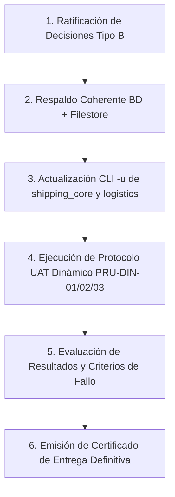

# PLAN DE ACCIÓN PARA ENTREGA DE OPERACIONES Y LOGÍSTICA
## ÁREA: OPERACIONES Y LOGÍSTICA — MADENAT
### Odoo 18 Community Edition

**Fecha:** 2026-10-29  
**Rama:** `lote5-desacople-shipping-20261029` | **HEAD:** `26d865d`  
**Estado General:** Apto con Condiciones (Sujeto a Despliegue, Ratificación y UAT)

---

## 1. CONDICIONES PREVIAS DE DESPLIEGUE (PENDIENTES DE EJECUCIÓN)

### COND-01: Actualización de Manifiestos en Base de Datos (HALL-OPLOG-01)
- **Categoría:** **d) Pendiente de despliegue.**
- **Situación:** En `madenat_test`, `ir_module_module` mantiene registradas versiones anteriores (`shipping_core` 18.0.1.0.0 y `logistics` 18.0.1.41.1) respecto a los manifiestos vigentes en disco (18.0.1.3.0 y 18.0.1.43.0).
- **Consecuencia Observable:** Riesgo de desfase en el registry de Odoo ante reinicios o actualizaciones parciales sin parámetro `-u`.
- **Acción Requerida:** Ejecutar actualización por línea de comandos sin HTTP:
  ```bash
  docker exec odoo18_app odoo -c /etc/odoo/odoo.conf -d madenat_test -u madenat_lumber_shipping_core,madenat_lumber_logistics --stop-after-init --no-http
  ```
- **Validación:** Comprobar en PostgreSQL que `latest_version` refleje `18.0.1.3.0` y `18.0.1.43.0` y que el log no registre errores de carga.

---

## 2. DECISIONES OPERATIVAS QUE DEBE RATIFICAR EL RESPONSABLE

Ningún hallazgo debe considerarse cerrado sin la intervención y decisión explícita de la Jefatura de Operaciones y Gerencia. Se presentan los puntos pendientes organizados por su prioridad técnica:

### PRIORIDAD 1: Integridad Física de Consumo en Maquila (DISC-OP-10) — [RESUELTO EN LOTE 6]
- **Categoría:** **a) Defecto demostrado (Corregido).**
- **Causa Confirmada:** En `toll_processing_order.py:316`, `_create_consumption_picking` forzaba `location_src_id = warehouse.lot_stock_id.id` (`WH/Stock`). Si el lote estaba en patios como `MARVAL` o `PUERTO CORONEL`, Odoo consumía de la raíz generando quants negativos ficticios en `WH/Stock` y manteniendo el saldo en el patio.
- **Solución Implementada (Opción A):**
  - Implementado `_get_lot_consumption_sources(lot, required_qty)` que inspecciona dinámicamente los quants internos del lote para la compañía activa.
  - Validación de disponibilidad libre real (`free = stock.quant._get_available_quantity(..., strict=True)`).
  - Soporte multi-ubicación si el lote está repartido entre patios.
  - Generación de movimientos nativos (`stock.move` y `stock.move.line` con `picked=True`) desde la ubicación física exacta del lote.
  - Cobertura de pruebas completa en `test_toll_consumption_and_processor.py`.

### PRIORIDAD 2: Selección del Procesador Maquilador (DISC-OP-09) — [VERIFICADO / NO DEFECTO DE CÓDIGO]
- **Categoría:** **b) No reproducido como defecto de código.**
- **Causa Analizada:** En `lumber_reception.py:37`, `action_create_toll_order` asigna `'processor_id': self.supplier_id.id` únicamente como sugerencia por defecto editable en borrador.
- **Dictamen:** El campo `processor_id` (`res.partner`, `is_processor=True`) es plenamente editable en la orden en estado borrador. El maquilador seleccionado se conserva intacto en confirmación (`sent`, `in_process`), en el albarán de consumo (`consumption_picking_id.partner_id`) y en la factura de proveedor (`account.move.partner_id`).
- **Solución Adoptada (Opción B):** No añadir selectores redundantes; se documentó el comportamiento canónico y se añadieron tests unitarios que acreditan que un procesador distinto al proveedor es admitido y conservado en todo el ciclo.

### PRIORIDAD 3: Salvoconducto de Borrado en Recepciones (DISC-OP-08)
- **Categoría:** **b) Decisión operativa pendiente.**
- **Consecuencia Observable:** En `lumber_reception`, la ACL fija `unlink = 0` para Jefatura de Operaciones. El borrado de registros erróneos o cancelados está bloqueado por UI. El staging documental ya utiliza `sudo()` controlado para limpiar líneas temporales.
- **Decisión del Responsable:**
  - *Opción A (Recomendada por Seguridad):* Mantener `unlink = 0` estricto en el modelo principal para evitar pérdidas accidentales de trazabilidad histórica.
  - *Opción B:* Otorgar `unlink = 1` a Jefatura de Operaciones exclusivamente para registros en estado `draft` o `cancel`, bajo el marco de la directriz AD-103.

### PRIORIDAD 4: Propagación de Lotes a Consumo Parcial en Maquila (DISC-OP-11)
- **Categoría:** **e) Hipótesis por verificar en UAT.**
- **Consecuencia Observable:** En `guia_processing_integration.py`, los lotes de la orden Toll no se copian automáticamente a las líneas O2M de consumo parcial de la guía de procesados. El usuario debe seleccionarlos manualmente.
- **Decisión del Responsable:** Evaluar en la prueba PRU-DIN-01 si la selección manual resulta aceptable o si la operación exige la propagación automática predeterminada.

---

## 3. MEJORAS NO BLOQUEANTES (MANTENER EN BACKLOG SIN MODIFICAR CÓDIGO)

Conforme a la instrucción de no alterar el código durante la auditoría, los siguientes cuatro puntos quedan catalogados como mejoras técnicas o cosméticas que **no impiden la operación**:

1. **DISC-LOG-14 (Claves de Contenedor `40hc` vs `40HC`):** Discrepancia cosmética de cadenas de texto. No altera la vinculación relacional Many2one entre contenedor y booking. Se mantiene sin cambio de claves para no invalidar registros de BD existentes.
2. **DISC-LOG-16 (Botones de Ciclo de Vida en Voyage):** La gestión naviera opera satisfactoriamente mediante fechas estimadas y reales. La inclusión de botones interactivos de estado queda en backlog de mejoras de interfaz.
3. **DISC-LOG-17 (MRO de Costeo en `_get_shipment_costs`):** El método base en logística y el override en costing operan limpiamente según el orden de resolución de métodos de Python. Se preserva el desacople.
4. **DISC-LOG-18 (Campos de Volumen `total_vol_shipment_m3` vs `total_volume_m3`):** Coexistencia de campos computados en contenedor. Se mantienen ambos para garantizar retrocompatibilidad con vistas y reportes PDF/XLSX.
5. **DISC-OP-06 (Falta de Suite en `madenat_toll_processing`):** El módulo no posee directorio `tests/`. No bloquea la operación pero se programa la creación de pruebas unitarias para el próximo sprint.
6. **DISC-OP-19 (Fixture .xls en Ingesta):** Cobertura de regresión de la regla V1 para formatos binarios BIFF8 programada como mejora de pruebas.
7. **DISC-LOG-19 (Asistente de Remate Bloque 7):** Reportabilidad multidimensional pos-zarpe diferida a especificación comercial.

---

## 4. ORDEN MÍNIMO DE EJECUCIÓN RECOMENDADO



### Detalle del Flujo de Ejecución:
1. **Fase 1: Acuerdos de Negocio:** El responsable ratifica las decisiones para DISC-OP-10, DISC-OP-09 y DISC-OP-08.
2. **Fase 2: Respaldo Coherente Obligatorio:**
   - Respaldo de BD PostgreSQL:
     ```bash
     docker exec odoo18_db pg_dump -U odoo -d madenat_test -Fc > ~/backups/madenat_test_pre_uat_$(date +%Y%m%d_%H%M).dump
     ```
   - Respaldo de Filestore (garantiza consistencia de adjuntos documentales):
     ```bash
     tar -czf ~/backups/filestore_madenat_test_pre_uat_$(date +%Y%m%d_%H%M).tar.gz /var/lib/odoo/.local/share/Odoo/filestore/madenat_test
     ```
3. **Fase 3: Actualización de Módulos (COND-01):**
   - Ejecución del comando de actualización `-u` en `madenat_test` para alinear metadatos en `ir_module_module`.
4. **Fase 4: Ejecución Dinámica de la UAT:**
   - Ejecutar en `madenat_test` (o en base temporal aislada `madenat_uat_temp`) los tres casos detallados en la Matriz de Pruebas:
     - `PRU-DIN-01`: Flujo end-to-end (ingreso normal, maquila con procesador distinto, retorno parcial, imputación documental SV, rebaja física única y zarpe).
     - `PRU-DIN-02`: Contingencias de zarpe con excepción B-01, rolleo de contenedor y regularización extemporánea R1.
     - `PRU-DIN-03`: Verificación interactiva de segregación de funciones entre Cristhian (Operaciones) y Felipe (Auditoría).
5. **Fase 5: Cierre Técnico:**
   - Si no se detectan criterios de fallo, emitir la acreditación final de entrega como **APTO PARA ENTREGA**.
   - Fusionar la rama `lote5-desacople-shipping-20261029` y etiquetar en git.

---

## 5. VALIDACIÓN REQUERIDA POR ACCIÓN

| Acción / Hallazgo | Tipo de Validación | Procedimiento / Comando | Criterio de Éxito |
|---|---|---|---|
| **COND-01 (Actualización módulos)** | Verificación SQL | `SELECT name, latest_version FROM ir_module_module WHERE name IN ('madenat_lumber_shipping_core', 'madenat_lumber_logistics');` | Versiones `18.0.1.3.0` y `18.0.1.43.0` exactas. |
| **DISC-OP-10 (Ubicación Toll)** | Prueba Funcional en UAT | Crear orden Toll con lote en `MARVAL`. Verificar campo `location_id` en albarán generado. | Albarán consume de `WH/Stock/MARVAL` y no de `WH/Stock`. |
| **DISC-OP-09 (Procesador Toll)** | Prueba Funcional en UAT | Generar orden Toll desde recepción con proveedor A, seleccionando procesador B. | Orden Toll y albarán emitidos a nombre del procesador B. |
| **PRU-DIN-01 (Doble Descuento)** | Verificación SQL tras rebaja | `SELECT count(*) FROM stock_move WHERE lot_id = <LOTE_SV> AND location_dest_id = 5;` | 0 movimientos de salida para el lote SV (sólo sale la tarja). |
| **PRU-DIN-03 (Segregación)** | Prueba de Interfaz Web | Iniciar sesión como Felipe Muñoz. Intentar acceder a Toll y crear un Viaje marítimo. | Menú Toll ausente; botones de edición deshabilitados o `AccessError`. |

---

## 6. ESTADO DE VALIDACIÓN TÉCNICA DEL LOTE 6 (2026-10-29)

- **Desbloqueo de Instalación (`madenat_lumber_core` 18.0.6.25.3)**: Corregido orden de carga en `__manifest__.py` reubicando `views/stock_quant_patio_views.xml` tras `views/lumber_core_menu.xml` para asegurar existencia previa de `madenat_lumber_core.menu_ops_inventory`.
- **Implementación OP-10 & UoM (`madenat_toll_processing` 18.0.1.1.0)**:
  - Consumo directo desde quants de patios físicos específicos (`MARVAL`, etc.).
  - Validación dimensional de categoría Volumen (`category_id`) y conversión canónica con redondeo nativo de la unidad (`product_uom.rounding`).
  - Idempotencia estricta distinguiendo albaranes activos de cancelados.
- **Suite de Pruebas Automatizadas (`test_toll_consumption_and_processor`)**:
  - Ejecutada en BD aislada `tmp_lote6_toll_20261029`: **9 tests ejecutados, 0 fallos, 0 errores, código de salida 0**.
  - Evidencia completa en logs `LOTE6_TEST_EXECUTION_RUN6.log` y `LOTE6_EXIT_CODE_RUN6.txt`.
- **Higiene y Limpieza**: Base de datos temporal y filestore eliminados y verificados. `madenat_test` sin tocar.
- **Pendiente para Entrega**: La validación administrativa en verde acredita la solvencia técnica del código, pero **NO sustituye ni declara acreditada la operación en terreno** de Cristhian y Felipe (UAT interactiva de fases 4 y 5 aún pendiente).
